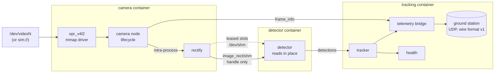

# onboard-perception-ros2

[](https://github.com/manojrevenkar12-web/onboard-perception-ros2/actions/workflows/ci.yml)

**Migrating a legacy single-process onboard tracker to ROS 2 without changing one byte of what the
ground station receives.** The repository contains:

- a V4L2 capture driver;
- a shared-memory image transport that works between Docker containers and falls back to raw by
  itself when it cannot;
- measurements of what each way of moving frames costs under a one-core CPU limit.

The starting point is `visionbox 2.3`: one C++ file with global state. It captures with `read()`,
undistorts, finds bright blobs, tracks them with a Kalman filter and streams UDP telemetry to a
ground station. The program was written for this repository to stand in for the monolith a team
inherits; from then on it is treated as the real thing.

The end point is a ROS 2 Jazzy system:

- a lifecycle camera node;
- rectify, detector and tracker components;
- a bridge that still speaks the old wire format;
- a health node.

It runs composed in one process, or split across processes or containers. The detector reads
rectified frames straight out of shared memory.



## What is in it, against the job

| The job says | Where it is |
|---|---|
| Migrate legacy monolithic systems to ROS 2, refactor and modularise | `legacy_visionbox` (frozen) → `opr_core` (algorithms, no ROS) → `opr_pipeline` components. [docs/MIGRATION.md](docs/MIGRATION.md) has the steps and seven findings in the legacy code, each fixed or deliberately kept. |
| Real-time perception pipelines on embedded platforms | Rectify (fixed-point lookup table), blob detector, Kalman + Hungarian tracker. Bit-identical on x86 and arm64 ([ADR 0006](docs/adr/0006-bit-exact-floating-point.md)); CI checks this under arm64 emulation. |
| Image data access across native and containerized components | `opr_shm` leased slots, `opr_shm_transport` image_transport plugin with automatic raw fallback, a zero-copy reader, `docker/compose.yaml` with three containers ([ADR 0004](docs/adr/0004-shared-memory-transport.md)). |
| Low-level camera and sensor drivers | `opr_v4l2`: QUERYCAP/S_FMT/S_PARM/REQBUFS/mmap/QBUF/DQBUF. Exposure timestamps, drop counting, refusal of silently changed formats, unplug and reconnect, pause without stale frames, a simulated device for tests ([ADR 0003](docs/adr/0003-own-the-camera-driver.md)). |
| Profile and debug under compute, thermal and bandwidth constraints | [reports/benchmarks](reports/benchmarks): every transport and every deployment, with and without a one-core limit. |
| Communication reliability and modularity | Lifecycle camera with managed bring-up order; per-node diagnostics; `perception_health` ([ADR 0005](docs/adr/0005-lifecycle-and-composition.md)). |
| Field testing | [docs/FIELD_CHECKLIST.md](docs/FIELD_CHECKLIST.md): what to check on a new vehicle, with the probe tool and what a good answer looks like. |

## Results

### The migration changed nothing the ground station can see

visionbox replays 21 simulated flights (7 kinds, 3 seeds each) and its 3,150 telemetry datagrams
are kept. Every test below compares bytes, not tolerances:

| What runs | Datagrams equal to visionbox 2.3 |
|---|---:|
| `opr_core` (the extracted library), 21 flights | **3,150 / 3,150** |
| The same, compiled for arm64 and run under emulation in CI | **3,150 / 3,150** |
| All ROS 2 nodes in one process, intra-process (occlusion flight) | **150 / 150** |
| Split into three processes; the detector reads shared memory in place (clutter flight) | **150 / 150** |

The split test first lost its first datagram: the camera started before the detector in the
other process had been discovered. In the field a lifecycle manager activates the camera after
everything downstream has subscribed. The tests now do the same, and the [ADR](docs/adr/0005-lifecycle-and-composition.md)
records why.

### Moving a 1080p frame between processes

Full table: [reports/benchmarks/transport.md](reports/benchmarks/transport.md). The test sends
1920x1080 YUYV frames (4 MB) at 30 Hz, 300 frames per run, on a 2 vCPU cloud VM.

| Path | Delivered | Latency p50 / p99 | CPU per frame | With both processes on one core |
|---|---:|---:|---:|---|
| raw, default QoS (best effort) | 94/300 | 3.7 / 7.6 ms | 3.4 ms | 13/300 delivered |
| raw, reliable QoS | 292/300 | 13.5 / 27.7 ms | 5.4 ms | 300/300, p50 24.2 ms |
| raw, Fast DDS LARGE_DATA | 102/300 | 3.9 / 6.5 ms | 3.7 ms | 12/300 delivered |
| **shm, one copy at the reader** | **300/300** | **2.3 / 5.1 ms** | **2.4 ms** | 300/300, p50 2.2 ms |
| **shm, read in place** | **300/300** | **1.4 / 3.9 ms** | **1.5 ms** | 300/300, p50 1.3 ms |
| intra-process (one process) | 300/300 | 1.2 / 3.2 ms | 2.7 ms | 300/300, p50 1.1 ms |

What this says:

- **Default best-effort transport loses most 4 MB frames.** The frames are larger than this
  machine's 4 MiB socket buffers (`net.core.rmem_max`). Reliable QoS gets them through by
  resending, at 10x the latency (24 ms p50 on one core). Fast DDS's LARGE_DATA profile behaved
  like the default here.
- **Shared memory delivers every frame, on one core too.** Reading in place even cost less CPU than
  intra-process within one process. The likely reason, not proven here: the copy into a slot reuses
  memory that is already mapped, while each intra-process message allocates a new 4 MB buffer.
- **At 640x480 the differences mostly disappear.** Every path delivers within a millisecond (see
  the full table). Small frames do not need this machinery; the case for it is camera resolution,
  not the deployment.

### The whole chain, camera to telemetry

Full table: [reports/benchmarks/pipeline.md](reports/benchmarks/pipeline.md). Simulated
640x480 camera at 30 Hz with 8 targets, 20 s per run, all the way to the telemetry bridge:

| Deployment | No limit: p50 / p99, CPU per frame | One core: p50 / p99, CPU per frame |
|---|---|---|
| one process, intra-process | 3.8 / 8.6 ms, 8.2 ms | 6.6 / 10.2 ms, 10.3 ms |
| 3 processes, raw images | 4.1 / 7.9 ms, 7.9 ms | 4.5 / 7.3 ms, 7.9 ms |
| 3 processes, shm + copy | 4.1 / 7.5 ms, 7.8 ms | 3.8 / 9.2 ms, 7.4 ms |
| 3 processes, shm in place | 4.0 / 8.1 ms, 7.7 ms | 3.9 / 8.1 ms, 7.2 ms |

Every deployment tracked every frame, give or take the one frame at the edge of the
measurement window.

- **At this camera's resolution, the deployment barely matters.** All of them use under a
  third of a frame period. CPU includes about 3 ms per frame for rendering the simulated camera.
- **Composition was not free on one core.** The composed container uses a multi-threaded
  executor, which competes with itself on a single core: its latency rose to 6.6 ms, while the
  split deployments stayed near 4 ms. On a busy companion computer, measure before assuming that
  composition is the fast option.
- **Shared memory matters at camera resolution, not at this one.** Shared memory in place was
  the cheapest split deployment, but the large win is at 1080p (the table above), where raw
  transport stops delivering frames at all.

### The camera driver, under faults

Tested against the simulated V4L2 device (`opr_v4l2/test`, `opr_pipeline/test`):

- **Exposure-time stamps.** Stamps come from the buffer, not the clock after `read()`.
  End-of-frame stamps are corrected by one interval.
- **Slow consumers and corrupted buffers.** Drops caused by a slow consumer are counted;
  corrupted buffers are skipped and counted.
- **Resolution changes.** A driver that changes the resolution makes `configure` fail before
  arming.
- **Unplug drill.**
  - In flight: the camera cable comes out for 1 s. `perception/health` goes to ERROR and returns
    to OK without a restart, and tracks resume.
  - The frame sequence keeps counting across the reconnect, so the outage appears as lost frames,
    not a restart (`test_camera_unplug.py`, `CameraNodeTest.AnUnplugIsALoudGapNotARestart`).
- **Pausing.** A paused (inactive) camera holds no stale frames when it resumes.

### Shared-memory correctness

A two-process stress test (`test_segment`) has a writer reuse slots as fast as it can. Meanwhile
a reader deliberately outstays its lease on every 7th frame. In a typical run:

- **211** frames changed mid-read and every one was refused;
- **0** inconsistent frames were accepted;
- a reader that skipped `validate()` would have used **211** corrupted frames.

### What the tracker does (the starting point, unchanged)

Full table: [reports/tracking.md](reports/tracking.md). Across all flights:

- **Recall 97.5%.** The misses are mostly the two frames every target needs before it is
  confirmed.
- **Position error.** 0.06 px mean and 0.12 px p95.
- **ID switches.** 20 across all flights: 17 in the 8-target swarm, and 3 in the occlusion
  flights, where an 8-frame occlusion is longer than the tracker's patience.
- **Ghost tracks (292 of 8,725 track-frames).** These come from two sources:
  - targets that overlap and briefly merge into one blob;
  - tracks that coast after their target has left the image.

These are visionbox's behaviour, kept on purpose for equivalence (finding 4 in
[MIGRATION.md](docs/MIGRATION.md)). Changing them is the first change after the migration, and
will be visible as a change.

## Run it

Build and test (ROS 2 Jazzy):

```bash
source /opt/ros/jazzy/setup.bash
rosdep install --from-paths src --ignore-src -y
colcon build --cmake-args -DCMAKE_BUILD_TYPE=Release
source install/setup.bash
colcon test && colcon test-result --verbose
```

Run the pipeline with the simulated camera, or with a real one:

```bash
ros2 launch opr_pipeline pipeline.launch.py                     # composed, simulated camera
ros2 launch opr_pipeline pipeline.launch.py mode:=split detector_zero_copy:=true
ros2 launch opr_pipeline pipeline.launch.py device:=/dev/video0 # a real camera
ros2 topic echo /perception/health
```

Three containers on one machine. `compose.isolated.yaml` shows the fallback:

```bash
docker build -f docker/Dockerfile -t onboard-perception-ros2:latest .
docker compose -f docker/compose.yaml up
docker compose -f docker/compose.yaml -f docker/compose.isolated.yaml up
```

On a Jetson (aarch64, CPU path), build the same Dockerfile for arm64 and add
`--device /dev/video0`. Then follow [docs/FIELD_CHECKLIST.md](docs/FIELD_CHECKLIST.md).

Benchmarks:

```bash
python3 src/opr_bench/scripts/run_transport.py reports/benchmarks
python3 src/opr_bench/scripts/run_pipeline.py reports/benchmarks
```

Replay a flight through visionbox and through the new code, and compare:

```bash
install/legacy_visionbox/lib/legacy_visionbox/visionbox --config src/legacy_visionbox/visionbox.ini \
  --replay swarm:2 --record /tmp/old.hex
install/opr_core/lib/opr_core/opr_replay swarm 2 /tmp/new.hex && cmp /tmp/old.hex /tmp/new.hex
```

## Packages

| Package | Depends on ROS | What |
|---|---|---|
| `opr_sim` | no | Deterministic camera simulator with ground truth. Integer and basic arithmetic only, so frames are bit-identical on every machine. |
| `legacy_visionbox` | no | The frozen monolith. |
| `opr_core` | no | Rectify, detect, track and the telemetry codec, plus `opr_replay` and `opr_evaluate`. |
| `opr_v4l2` | no | V4L2 capture driver, the simulated device and `opr_v4l2_probe`. |
| `opr_shm` | no | Leased shared-memory image slots. |
| `opr_msgs` | yes | `ShmImage`, `FrameInfo`, `DetectionArray`, `TrackArray`, `Health`. |
| `opr_shm_transport` | yes | image_transport `shm` plugin and the dual raw/shm publisher. |
| `opr_pipeline` | yes | The components, launch files and parameters, plus launch drills. |
| `opr_bench` | yes | The benchmarks. |

Decisions are in [docs/adr](docs/adr):

- characterise the legacy code before changing it;
- keep the algorithms free of ROS;
- write our own camera driver;
- shared memory with leases;
- lifecycle nodes and composition;
- bit-exact floating point.

## Limits

- **No real camera and no Jetson were used.** The driver is tested against a simulated device
  that answers the same ioctls. Its behaviour on real UVC or CSI cameras (timestamp flags,
  `S_PARM` support, reconnect timing) must be checked on the vehicle with `opr_v4l2_probe`
  (docs/FIELD_CHECKLIST.md). Every benchmark ran on a 2 vCPU cloud VM: the ratios between paths
  are the useful part, not the milliseconds.
- **Containers are tested only in CI.** The three-container deployment and the fallback are
  exercised in GitHub Actions; this development machine has no Docker daemon.
- **The perception is deliberately simple.** It is a classical blob detector and tracker, so the
  migration can be checked exactly. A learned detector on the Jetson's GPU (TensorRT) would sit
  where `detector` is. It would read the same shared-memory slots, and would be compared by
  tracking metrics, not by bytes.
- **One copy remains between the sensor and the consumers.** Capturing straight into the
  shared-memory slots (V4L2 `USERPTR`/DMABUF) would remove it; this is not done yet.
- **The legacy program and the flights are invented.** Every flight is simulated. The ground
  truth makes the tracking numbers exact, but says nothing about real sky, real lenses or real
  targets.
